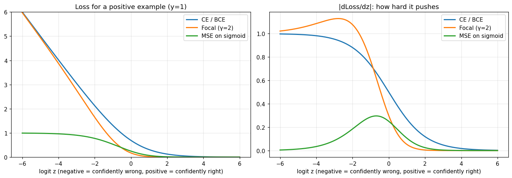
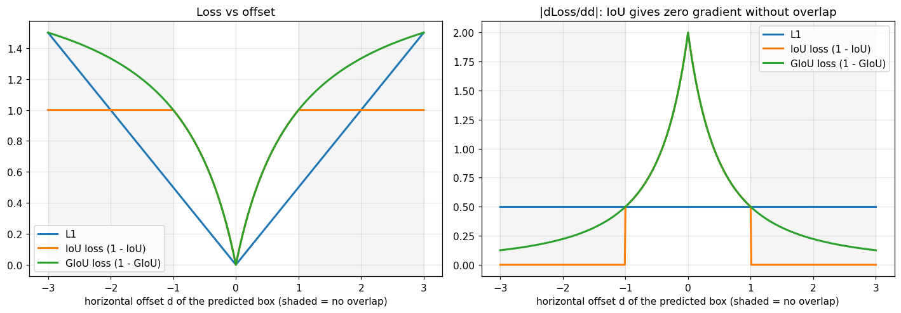
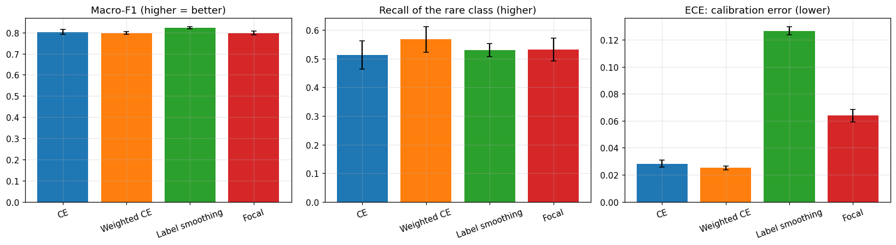
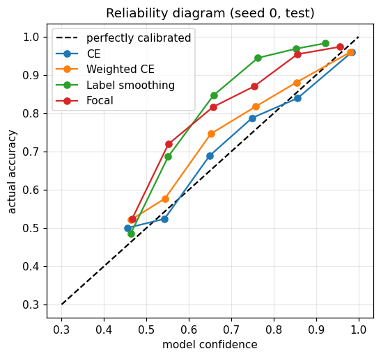
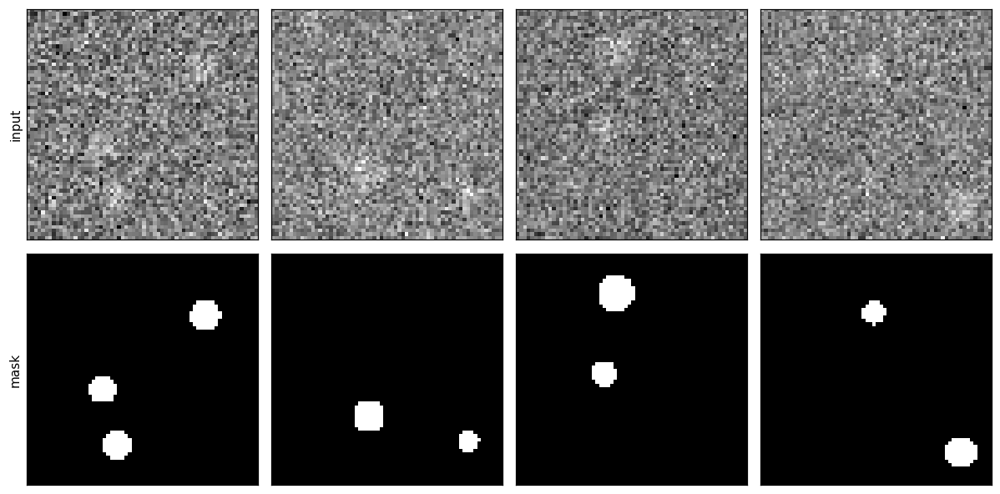
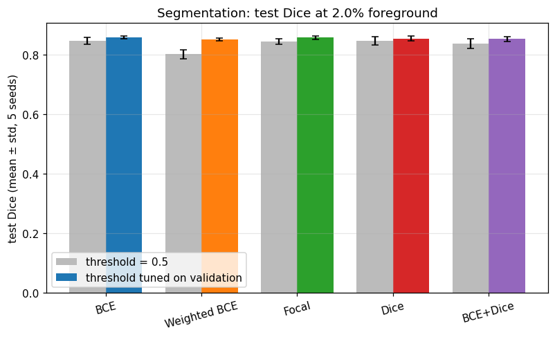
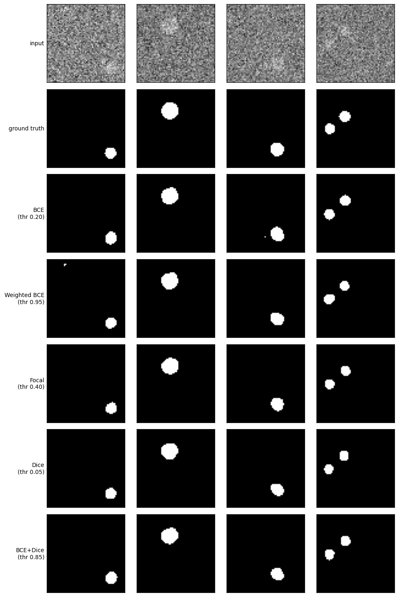
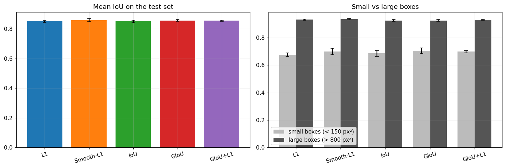
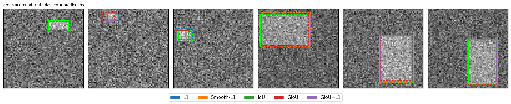

# Loss Functions Explained & Compared

One notebook, three tasks: **classification, segmentation and detection.** Each task asks the model a different question, so each uses a different loss. For every task the notebook explains the main losses, verifies a from-scratch implementation, and compares a few of them fairly on controlled synthetic data.

| Task | Losses compared | What it shows |
|---|---|---|
| **Classification** (3 classes, 80/15/5% imbalance, 3% label noise) | Cross-Entropy · Weighted CE · Label Smoothing · Focal | Imbalance, overconfidence and calibration (ECE) |
| **Segmentation** (foreground ≈ 2% of pixels) | BCE · Weighted BCE · Focal · Dice · BCE+Dice | Per-pixel cross-entropy vs directly optimizing overlap; why accuracy is misleading |
| **Detection** (box regression, boxes of very different sizes) | L1 · Smooth-L1 · IoU · GIoU · GIoU+L1 | Coordinate losses vs the metric itself; zero gradient without overlap; small vs large boxes |

Companion project: [optimizers-compared-fairly](https://github.com/Yossefmohammed/optimizers-compared-fairly) (same protocol, applied to optimizers).

## TL;DR

<!-- Fill in after running the notebook: 3 bullets taken from the Key findings below. -->

## What makes the comparison fair

| Concern | How it is handled |
|---|---|
| Loss values are not comparable across losses | Compare **task metrics** (Macro-F1, ECE, Dice, IoU, ...) on held-out data, never loss values |
| Accuracy hides failure | Accuracy / pixel accuracy is reported next to trivial baselines (majority class, "all background") |
| Wrong implementation | Each loss re-implemented from scratch and checked against PyTorch (`F.cross_entropy`, `F.binary_cross_entropy_with_logits`, `F.smooth_l1_loss`, torchvision IoU/GIoU) or hand-computed cases |
| One setting for everyone | Each loss gets its own small hyperparameter grid, selected on **validation** data |
| Tuning on the test set | Test metrics are computed only in the final runs and never feed back into any choice |
| A single lucky run | **3 seeds (100–102) for selection, 5 separate seeds (0–4) for the final evaluation**, mean ± std |
| Threshold luck (segmentation) | The threshold is tuned on validation for each model; results at 0.5 are shown too |
| Optimizer / LR confound | Same optimizer for all (Adam, lr = 1e-3), which is nearly invariant to the scale of the loss |

## The losses at a glance

**Classification** (`p_y` = predicted probability of the true class)

| Loss | Formula | Idea |
|---|---|---|
| Cross-Entropy | `−log p_y` | Maximum likelihood; the default |
| Weighted CE | `w_y · (−log p_y)` | Up-weights rare classes |
| Label Smoothing | `(1−ε)(−log p_y) + ε·mean_c(−log p_c)` | Discourages overconfidence; helps with noisy labels |
| Focal | `−(1−p_y)^γ log p_y` | Down-weights easy examples |

**Segmentation** (per pixel, `p = σ(z)`)

| Loss | Formula | Idea |
|---|---|---|
| BCE | `−[y log p + (1−y) log(1−p)]` | Binary cross-entropy per pixel |
| Weighted BCE | positive term × `w` | Compensates for rare foreground |
| Focal | `−α_t (1−p_t)^γ log p_t` | Focus on hard pixels |
| Dice | `1 − (2TP+s)/(2TP+FP+FN+s)` | Optimizes overlap directly |
| BCE+Dice | `BCE + Dice` | Stability + overlap |

**Detection = classification loss + box-regression loss.** The classification part reuses CE / Focal (Focal was invented for the extreme foreground/background imbalance among anchors; the notebook shows this with a numeric example). For the box:

| Loss | Idea | Weakness |
|---|---|---|
| L1 / Smooth-L1 | Distance between coordinates | Not scale-invariant; not the evaluation metric |
| IoU loss `1 − IoU` | Matches the metric, scale-invariant | **Zero gradient when boxes do not overlap** |
| GIoU loss | IoU minus the empty area of the enclosing box | Gradient even without overlap |
| GIoU + L1 | Common combination (DETR-style) | Extra weight to tune |





## Results

<!-- After running the notebook, paste the three tables from results/classification.md, results/segmentation.md and results/detection.md here. -->

### Classification




### Segmentation






### Detection




## Key findings

<!-- Fill in from the results. Questions to answer:
1. Which differences are larger than the seed-to-seed std, and which are not?
2. Classification: what did Weighted CE do to minority recall and calibration? What did Label Smoothing do to ECE?
3. Segmentation: how much did the threshold matter? Did pixel accuracy distinguish the losses at all?
4. Detection: did the IoU-based losses help on small boxes?
5. Where do the findings contradict the usual advice? -->

## When to use which loss (starting points)

These come from the literature and common practice, **not from this study**. Confirm on your own data.

| Task | Common starting point | Switch when |
|---|---|---|
| Classification | Cross-entropy | Label smoothing for overconfidence or noisy labels; class-weighted CE or resampling for moderate imbalance (check calibration afterwards); Focal for extreme imbalance with many easy examples |
| Segmentation | BCE / CE | BCE + Dice when the foreground is small and the metric is overlap; Dice / Tversky when recall matters (small lesions) |
| Detection, classification head | CE | Focal when thousands of anchors are mostly background (commonly cited defaults: α = 0.25, γ = 2) |
| Detection, box regression | L1 / Smooth-L1 | IoU-based (GIoU / DIoU / CIoU) when the metric is IoU or box sizes vary a lot |
| Regression | MSE (quadratic penalty) | MAE for robustness to outliers; Huber as a compromise |

**Rule of thumb:** match the loss to the question you care about; judge by the task metric, not accuracy or the loss value; tune hyperparameters (and the threshold) per loss; and check whether a difference is bigger than the seed-to-seed noise before believing it.

## Run it

```bash
pip install -r requirements.txt
jupyter notebook losses_explained_and_compared.ipynb   # Run All; a GPU is optional (small models, ~130 short runs)
```

Outputs are written to `figures/` and `results/`.

## Limitations

- Synthetic data: results may not transfer to real images (e.g. real SAR oil spills have complex shapes, speckle noise and many look-alikes).
- The detection part is **single-object localization**, not a full detector (no anchors, NMS or multi-object matching); the detector's classification loss is explained with a numeric example, not trained.
- Small models, short training; optimizer and learning rate are fixed (1e-3), which may suit some losses more than others.
- Small hyperparameter grids; the selection metric differs per task (Macro-F1, Dice, mean IoU).
- Dice loss is computed over the whole batch, not per image.

## Possible extensions

CIoU / DIoU · Tversky / Focal-Tversky · Lovász-hinge · a full detector (e.g. torchvision) · real Sentinel-1 data with SegFormer · per-loss learning-rate sweep.

## References

- Lin et al., *Focal Loss for Dense Object Detection*, 2017.
- Milletari et al., *V-Net* (Dice loss), 2016.
- Rezatofighi et al., *Generalized Intersection over Union*, 2019.
- Szegedy et al., *Rethinking the Inception Architecture* (label smoothing), 2016.
